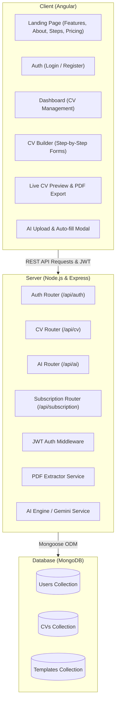

# 🏗️ المعمارية التقنية للمشروع (System Architecture)

تعتمد المنصة على معمارية العميل والخادم المتكاملة (**Client-Server Architecture**) باستخدام **MEAN Stack**:



---

## 🗄️ 1. نماذج بيانات MongoDB (Schemas)

### أ) نموذج المستخدم `User`
```typescript
{
  name: { type: String, required: true },
  email: { type: String, required: true, unique: true },
  password: { type: String, required: true }, // Encrypted with bcrypt
  plan: { 
    type: String, 
    enum: ['free', 'pro', 'enterprise'], 
    default: 'free' 
  },
  aiCredits: { type: Number, default: 3 }, // Free credits for AI parsing
  subscriptionExpiresAt: { type: Date, default: null },
  createdAt: { type: Date, default: Date.now }
}
```

### ب) نموذج السيرة الذاتية `CV`
```typescript
{
  userId: { type: mongoose.Schema.Types.ObjectId, ref: 'User', required: true },
  title: { type: String, default: 'سيرتي الذاتية الجديدة' },
  templateId: { type: String, default: 'modern-clean' },
  themeColor: { type: String, default: '#2563eb' },
  fontFamily: { type: String, default: 'Tajawal' },

  // 1. البيانات الشخصية (Personal Info)
  personalInfo: {
    fullName: String,
    jobTitle: String,
    email: String,
    phone: String,
    address: String,
    summary: String,
    avatarUrl: String,
    website: String,
    linkedin: String,
    github: String
  },

  // 2. الخبرات الوظيفية (Work Experience)
  experiences: [{
    company: String,
    position: String,
    location: String,
    startDate: String,
    endDate: String,
    isCurrent: Boolean,
    description: String
  }],

  // 3. البيانات التعليمية (Education)
  education: [{
    institution: String,
    degree: String,
    fieldOfStudy: String,
    graduationYear: String,
    grade: String,
    description: String
  }],

  // 4. المهارات (Skills)
  skills: [{
    name: String,
    level: { type: String, enum: ['مبتدئ', 'متوسط', 'متقدم', 'خبير'], default: 'متقدم' }
  }],

  // 5. اللغات (Languages)
  languages: [{
    name: String,
    proficiency: { type: String, enum: ['أساسي', 'جيد', 'طلاقة', 'اللغة الأم'], default: 'طلاقة' }
  }],

  // 6. الشهادات والدورات (Certifications)
  certifications: [{
    name: String,
    issuer: String,
    issueDate: String,
    credentialUrl: String
  }],

  // 7. المشاريع والإنجازات (Projects)
  projects: [{
    title: String,
    description: String,
    link: String
  }],

  // 8. المراجع المهنية (References)
  references: [{
    name: String,
    jobTitle: String,
    company: String,
    email: String,
    phone: String
  }],

  createdAt: { type: Date, default: Date.now },
  updatedAt: { type: Date, default: Date.now }
}
```

---

## 🌐 2. نقاط النهاية للـ API (REST Endpoints)

| المسار (Endpoint) | الطريقة (Method) | الوصف | الحماية |
|---|---|---|---|
| `/api/auth/register` | POST | إنشاء حساب جديد | عام |
| `/api/auth/login` | POST | تسجيل الدخول واستلام JWT | عام |
| `/api/auth/me` | GET | جلب بيانات المستخدم الحالي وصلاحياته | محمي (JWT) |
| `/api/auth/upgrade` | POST | ترقية الحساب إلى Pro أو شراء رصيد | محمي (JWT) |
| `/api/cv` | GET | جلب قائمة السير الذاتية للمستخدم | محمي (JWT) |
| `/api/cv` | POST | إنشاء سيرة ذاتية جديدة | محمي (JWT) |
| `/api/cv/:id` | GET | جلب سيرة ذاتية محددة بتفاصيلها | محمي (JWT) |
| `/api/cv/:id` | PUT | تحديث بيانات السيرة الذاتية | محمي (JWT) |
| `/api/cv/:id` | DELETE | حذف سيرة ذاتية | محمي (JWT) |
| `/api/ai/parse-resume` | POST | رفع ملف سيرة ذاتية واستخراج البيانات عبر الذكاء الاصطناعي | محمي (JWT) |
| `/api/ai/enhance-text` | POST | تحسين النبذة أو الوصف بالذكاء الاصطناعي | محمي (JWT) |
